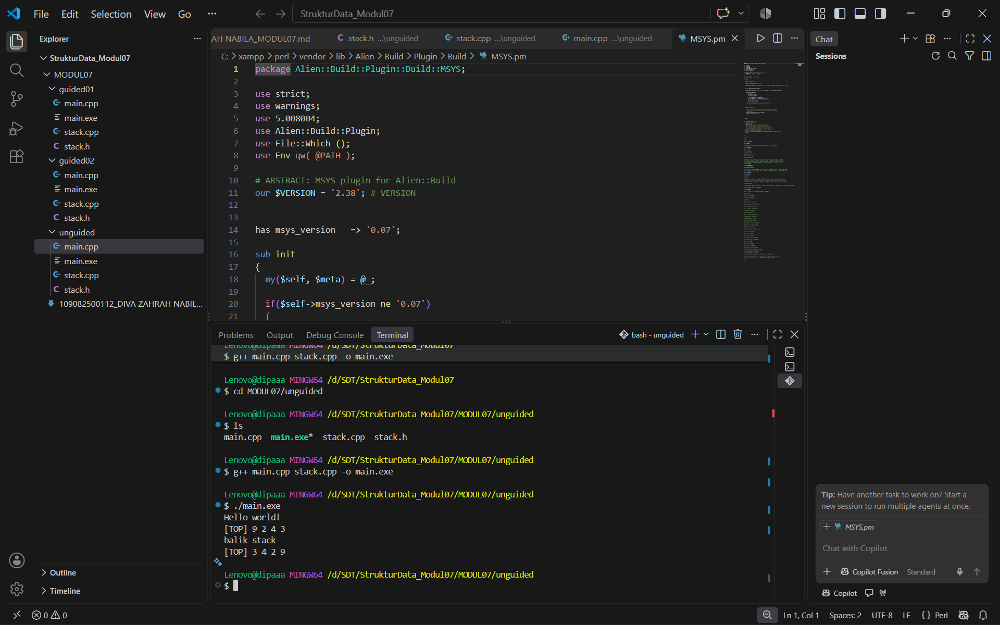

# <h1 align="center">Laporan Praktikum Modul 7 - STACK (BAGIAN PERTAMA)- ... </h1>
<p align="center">[Diva Zahrah Nabila] - [109082500112]</p>

## Unguided 

# Dasar Teori
## Stack adalah struktur data linier yang bekerja menggunakan prinsip tumpukan, yaitu LIFO (Last In, First Out), di mana elemen yang terakhir kali dimasukkan adalah elemen yang pertama kali diakses atau diambil. Berbeda dengan linked list biasa, seluruh operasi penyisipan dan penghapusan data pada stack hanya dapat dilakukan melalui satu pintu masuk yang berada di posisi paling atas bernama Top. 
## Terdapat dua operasi utama dalam stack:
## -- Push: Operasi menyisipkan atau menambahkan elemen baru ke posisi paling atas (Top) tumpukan.   
## -- Pop: Operasi mengambil sekaligus menghapus elemen yang berada di posisi paling atas (Top) tumpukan.   
## Secara implementasi, stack dapat dibangun menggunakan representasi pointer (alokasi memori dinamis seperti Singly Linked List sehingga kapasitasnya fleksibel) maupun representasi tabel/array (menggunakan array berindeks dengan kapasitas maksimum tertentu dan tidak memerlukan alokasi/dealokasi memori manual)


# GUIDED 1
### stack.h: 

```cpp
#ifndef STACK_TABLE
#define STACK_TABLE

#include <iostream>
using namespace std;

const int MAX = 10;

struct stackTable
{
    int data[MAX];
    int top;
};

bool isEmpty(stackTable s);
bool isFull(stackTable s);
void createStack(stackTable &s);
void push(stackTable &s, int angka);
void pop(stackTable &s);
void update(stackTable &s, int posisi);
void view(stackTable s);
void searchData(stackTable s, int Data);

#endif
``` 

### stack.cpp
```cpp
#include "stack.h"
#include <iostream>
using namespace std;

bool isEmpty(stackTable s)
{
    return s.top == -1;
}

bool isFull(stackTable s)
{
    return s.top == MAX - 1;
}

void createStack(stackTable &s)
{
    s.top = -1;
}

void push(stackTable &s, int angka)
{
    if (isFull(s))
    {
        cout << "Stack penuh!" << endl;
    }
    else
    {
        s.top++;
        s.data[s.top] = angka;
        cout << "Data " << angka << " berhasil ditambahkan kedalam stack!" << endl;
    }
}

void pop(stackTable &s)
{
    if (isEmpty(s))
    {
        cout << "Stack kosong!" << endl;
    }
    else
    {
        int val = s.data[s.top];
        s.top--;
        cout << "Data " << val << " berhasil dihapus dari stack!" << endl;
    }
}

void update(stackTable &s, int posisi)
{
    if (isEmpty(s))
    {
        cout << "Stack kosong!" << endl;
        return; 
    }
    if (posisi <= 0)
    {
        cout << "Posisi tidak valid!" << endl;
        return;
    }

    int idx = s.top - (posisi - 1);
    if (idx < 0 || idx > s.top)
    {
        cout << "Posisi " << posisi << " tidak valid!" << endl;
        return;
    }

    cout << "Update data posisi ke-" << posisi << endl;
    cout << "Masukkan angka : ";
    cin >> s.data[idx];
    cout << "Data berhasil diupdate!" << endl;
    cout << endl;
}

void view(stackTable s)
{
    if (isEmpty(s))
    {
        cout << "Stack kosong!" << endl;
    }
    else
    {
        for (int i = s.top; i >= 0; --i)
        {
            cout << s.data[i] << " ";
        }
    }
    cout << endl;
}

void searchData(stackTable s, int data)
{
    if (isEmpty(s))
    {
        cout << "Stack kosong!" << endl;
        return;
    }

    cout << "Mencari data " << data << "..." << endl;
    int posisi = 1;
    bool found = false;

    for (int i = s.top; i >= 0; --i)
    {
        if (s.data[i] == data)
        {
            cout << "Data " << data << " ditemukan pada posisi ke-" << posisi << endl;
            cout << endl;
            found = true;
            break;
        }
        posisi++;
    }

    if (!found)
    {
        cout << "Data " << data << " tidak ditemukan didalam stack!" << endl;
        cout << endl;
    }
}
```

### main.cpp:
```cpp
#include "stack.h"
#include <iostream>

using namespace std;

int main()
{
    stackTable s;
    createStack(s);

    push(s, 1);
    push(s, 2);
    push(s, 3);
    push(s, 4);
    push(s, 5);
    cout << endl;

    cout << "--- Stack setelah push ---" << endl;
    view(s);
    cout << endl;

    pop(s);
    pop(s);
    cout << endl;

    cout << "--- Stack setelah pop 2 kali ---" << endl;
    view(s);
    cout << endl;

    update(s, 2);
    update(s, 1);
    cout << endl;

    cout << "--- Stack setelah update ---" << endl;
    view(s);
    cout << endl;

    searchData(s, 4);
    searchData(s, 9);

    return 0;
}
```
### Penjelasan: Program guided01 mengimplementasikan struktur data Stack berbasis array statis (stackTable) berkapasitas maksimal 10 elemen dengan prinsip Last In, First Out (LIFO). Berkas stack.h bertindak sebagai cetak biru yang mendefinisikan struktur tumpukan beserta indeks penanda puncak (top) dan prototipe fungsinya, sedangkan stack.cpp memuat logika pengoperasian data yang meliputi penambahan (push) dan penghapusan (pop) elemen teratas dengan menggeser indeks top, serta pembaruan (update), penayangan (view), dan pencarian (searchData) melalui penelusuran mundur dari puncak ke dasar array. Seluruh fungsi tersebut kemudian dieksekusi secara berurutan di dalam main.cpp untuk menguji pengisian lima angka, penghapusan dua angka teratas, pembaruan data melalui input pengguna, hingga pencarian nilai tertentu di dalam tumpukan.

# GUIDED 2
### 1. stack.h

```cpp
#ifndef STACK
#define STACK
#define Nil NULL 
#include <iostream>
using namespace std;

typedef struct node *address;

struct node {
    int dataAngka;
    address next;
};

struct stack {
    address top;
};

bool isEmpty(stack listStack);
void createStack(stack &listStack);
address alokasi(int angka);
void dealokasi(address &node);

void push(stack &listStack, address nodeBaru);
void pop(stack &listStack);
void update(stack &listStack, int posisi);
void view(stack listStack);
void searchData(stack listStack, int data);

#endif
```

### 2. stack.cpp
```cpp
#include "stack.h"
#include <iostream>
using namespace std;

bool isEmpty(stack listStack) {
    return listStack.top == Nil;
}

void createStack(stack &listStack) {
    listStack.top = Nil;
}

address alokasi(int angka) {
    address nodeBaru = new node;
    nodeBaru->dataAngka = angka;
    nodeBaru->next = Nil;
    return nodeBaru;
}

void dealokasi(address &node) {
    node->next = Nil;
    delete node;
    node = Nil;
}

void push(stack &listStack, address nodeBaru) {
    nodeBaru->next = listStack.top;
    listStack.top = nodeBaru;
    cout << "Node " << nodeBaru->dataAngka << " berhasil ditambahkan kedalam stack!" << endl;
}

void pop(stack &listStack) {
    address nodeHapus;
    if (isEmpty(listStack) == true) {
        cout << "Stack kosong!" << endl;
    } else {
        nodeHapus = listStack.top;
        listStack.top = listStack.top->next;
        nodeHapus->next = Nil;
        cout << "Node " << nodeHapus->dataAngka << " berhasil dihapus dari stack!" << endl;
        dealokasi(nodeHapus);
    }
}

void update(stack &listStack, int posisi) {
    if (isEmpty(listStack) == true) {
        cout << "Stack kosong!" << endl;
    } else {
        if (posisi <= 0) {
            cout << "Posisi tidak valid!" << endl;
        } else {
            address nodeBantu = listStack.top;
            int count = 1;
            bool found = false;
            while (nodeBantu != Nil) {
                if (count < posisi) {
                    nodeBantu = nodeBantu->next;
                    count++;
                } else if (count == posisi) {
                    cout << "Update node posisi ke-" << posisi << endl;
                    cout << "Masukkan angka : ";
                    cin >> nodeBantu->dataAngka;
                    cout << "Data berhasil diupdate!" << endl << endl;
                    found = true;
                    break;
                }
            }
            if (found == false) {
                cout << "Posisi " << posisi << " tidak valid!" << endl;
            }
        }
    }
}

void view(stack listStack) {
    if (isEmpty(listStack) == true) {
        cout << "List kosong!" << endl;
    } else {
        address nodeBantu = listStack.top;
        while (nodeBantu != Nil) {
            cout << nodeBantu->dataAngka << " ";
            nodeBantu = nodeBantu->next;
        }
    }
    cout << endl;
}

void searchData(stack listStack, int data) {
    if (isEmpty(listStack) == true) {
        cout << "List kosong!" << endl;
    } else {
        address nodeBantu = listStack.top;
        int posisi = 1;
        bool found = false;
        cout << "Mencari data " << data << "..." << endl;
        while (nodeBantu != Nil) {
            if (nodeBantu->dataAngka == data) {
                cout << "Data " << data << " ditemukan pada posisi ke-" << posisi << endl << endl;
                found = true;
                break;
            } else {
                posisi++;
                nodeBantu = nodeBantu->next;
            }
        }
        if (found == false) {
            cout << "Data " << data << " tidak ditemukan didalam stack!" << endl << endl;
        }
    }
}
```

### 3. main.cpp
```cpp
#include "stack.h"
#include <iostream>
using namespace std;

int main() {
    stack listStack;
    address nodeA, nodeB, nodeC, nodeD, nodeE = Nil;
    createStack(listStack);

    nodeA = alokasi(1);
    nodeB = alokasi(2);
    nodeC = alokasi(3);
    nodeD = alokasi(4);
    nodeE = alokasi(5);

    push(listStack, nodeA);
    push(listStack, nodeB);
    push(listStack, nodeC);
    push(listStack, nodeD);
    push(listStack, nodeE);
    cout << endl;

    cout << "--- Stack setelah push ---" << endl;
    view(listStack);
    cout << endl;

    pop(listStack);
    pop(listStack);
    cout << endl;

    cout << "--- Stack setelah pop 2 kali ---" << endl;
    view(listStack);
    cout << endl;

    update(listStack, 2);
    update(listStack, 1);
    update(listStack, 4);
    cout << endl;

    cout << "--- Stack setelah update ---" << endl;
    view(listStack);
    cout << endl;

    searchData(listStack, 4);
    searchData(listStack, 9);

    return 0;
}
```

### Penjelasan: Program Guided 2 mengimplementasikan struktur data Stack menggunakan representasi pointer (Linked List dinamis) dengan prinsip Last In, First Out (LIFO), sehingga kapasitas tumpukan tidak dibatasi ukuran array statis. Berkas stack.h berperan sebagai cetak biru yang mendefinisikan struktur node beserta penunjuk puncak top dan daftar prototipe fungsinya, sementara stack.cpp mengatur logika alokasi memori dinamis (new dan delete), penyambungan pointer next saat menyisipkan (push) maupun menghapus (pop) node paling atas, serta penelusuran berantai dari top ke bawah untuk fitur update, view, dan searchData. Seluruh fungsi tersebut kemudian diuji secara berurutan di dalam main.cpp dengan memasukkan lima buah node, menghapus dua node teratas, memperbarui nilai pada posisi tertentu melalui input pengguna, hingga mencari keberadaan angka di dalam tumpukan.


# Unguided
### 1. Stack.h
```cpp
#ifndef STACK_H
#define STACK_H

#include <iostream>
using namespace std;

typedef int infotype;

struct Stack {
    infotype info[20];
    int top;
};

void createStack(Stack &S);
bool isEmpty(Stack S);
bool isFull(Stack S);
void push(Stack &S, infotype x);
void Push(Stack &S, infotype x); 
infotype pop(Stack &S);
void printInfo(Stack S);
void balikStack(Stack &S);

void pushAscending(Stack &S, infotype x);
void getInputStream(Stack &S);

#endif
```


### 2. stack.cpp

```cpp
#include "stack.h"

void createStack(Stack &S)
{
    S.top = -1;
}

bool isEmpty(Stack S)
{
    return S.top == -1;
}

bool isFull(Stack S)
{
    return S.top == 19;
}

void push(Stack &S, infotype x)
{
    if (!isFull(S))
    {
        S.top++;
        S.info[S.top] = x;
    }
    else
    {
        cout << "Stack penuh!" << endl;
    }
}

void Push(Stack &S, infotype x)
{
    push(S, x);
}

infotype pop(Stack &S)
{
    if (!isEmpty(S))
    {
        infotype x = S.info[S.top];
        S.top--;
        return x;
    }
    else
    {
        cout << "Stack kosong!" << endl;
        return -1;
    }
}

void printInfo(Stack S)
{
    cout << "[TOP] ";
    for (int i = S.top; i >= 0; i--)
    {
        cout << S.info[i] << " ";
    }
    cout << endl;
}

void balikStack(Stack &S)
{
    Stack temp1, temp2;
    createStack(temp1);
    createStack(temp2);

    while (!isEmpty(S))
    {
        push(temp1, pop(S));
    }
    while (!isEmpty(temp1))
    {
        push(temp2, pop(temp1));
    }
    while (!isEmpty(temp2))
    {
        push(S, pop(temp2));
    }
}

void pushAscending(Stack &S, infotype x)
{
    Stack temp;
    createStack(temp);

    while (!isEmpty(S) && S.info[S.top] > x)
    {
        push(temp, pop(S));
    }
    push(S, x);
    while (!isEmpty(temp))
    {
        push(S, pop(temp));
    }
}

void getInputStream(Stack &S)
{
    char c;
    while (cin.get(c) && c != '\n')
    {
        if (c >= '0' && c <= '9')
        {
            push(S, c - '0');
        }
    }
}
```

### 3. stack main.cpp

```cpp
#include "stack.h"

int main()
{
    cout << "Hello world!" << endl;
    Stack S;
    createStack(S);
    Push(S, 3);
    Push(S, 4);
    Push(S, 8);
    pop(S);
    Push(S, 2);
    Push(S, 3);
    pop(S);
    Push(S, 9);
    printInfo(S);
    cout << "balik stack" << endl;
    balikStack(S);
    printInfo(S);
    return 0;
}
```


### Output :



## PENJELASAN PROGRAM
[Program ini mengimplementasikan struktur data Stack berbasis array berkapasitas 20 elemen (info[20]) dengan indeks top bernilai -1 saat tumpukan masih kosong. Berkas stack.h mendefinisikan struktur Stack dan prototipe seluruh fungsi, sedangkan stack.cpp mengatur logika manipulasi datanya. Fungsi push menaikkan indeks top lalu menyimpan data baru, sedangkan pop mengambil data pada posisi top dan menurunkan indeksnya. Untuk membalik urutan tumpukan pada balikStack, elemen dipindahkan secara berantai melalui dua stack sementara sehingga elemen dasar berpindah ke posisi top. Pada pushAscending, elemen yang nilainya lebih besar dari input baru dipindahkan sementara ke temp sebelum nilai baru disisipkan agar tumpukan tetap terurut. Sementara itu, getInputStream menggunakan cin.get() untuk membaca setiap karakter angka yang diketikkan pengguna hingga tombol Enter (\n) ditekan dan langsung mendorongnya masuk ke dalam stack.]

# Kesimpulan
[Praktikum Modul 7 ini menunjukkan bahwa struktur data Stack efektif digunakan untuk mengelola data yang membutuhkan urutan pemrosesan Last In, First Out (LIFO), di mana seluruh akses terpusat pada satu titik (Top). Penggunaan representasi array membuat manajemen memori menjadi lebih sederhana tanpa perlu alokasi pointer dinamis, serta mempermudah pengembangan operasi lanjutan seperti pengurutan elemen saat penyisipan (pushAscending), pembalikan urutan tumpukan (balikStack), hingga pembacaan aliran input karakter secara langsung (getInputStream).]


### Referensi
#### Modul pembelajaran


